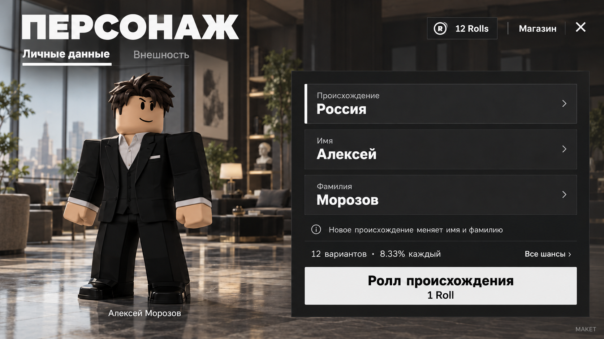

# Character and navigation redesign

The user rejected V132/V93's dense H window, lower controls in both scenes,
and colored/dark lighting. They explicitly chose two H tabs, a bold unusual
presentation, neutral bright lighting, and delegated lower navigation design.
The user approved the shown concept's composition but explicitly rejected the
yellow accent. Use large white typography, graphite surfaces, an off-white
primary action, white selection markers and a large actual avatar. The approved
neutral concept is linked below; its room/avatar are illustrations, not assets.

## H flow

Exactly two primary tabs: Личные данные / Внешность. Personal data is the
default; choosing a field selects a target without spending. The three fields
are Происхождение / Имя / Фамилия. One primary action names the selected target
and costs 1 Roll. Selecting appearance exposes cosmetic categories and the
equipped item; its primary action names the selected category. Avatar preview,
target and cost stay visible on narrow screens. Owned items and all chances
are explicit secondary actions. Actual server probabilities remain visible.
No hidden click target should imply a purchase. No decorative pseudo dossier
codes, giant SC stamp or burgundy portrait plate.

Keep the existing accessoryRoll UI create/open/close/resize/update/receive
contract and server requests. Retained request IDs must survive tab changes,
close/reopen, missing DTOs and match phase transitions. No new wallet grants.

## Lower navigation

One slim coherent lower row per scene, clear names and a distinguished primary
gameplay action. Keep play, character, store, daily, profile, trade and settings
reachable in the lobby; keep role card, chat, finish turn, spy guess and
secondary match actions with existing phase/role guards. Quick phrases do not
need a separate overlapping persistent slab. No lower controls can remain
above a phone, H, trade, entry or teleport overlay. Minimum touch target 44px.

## Light

White source/grade/ViewportFrame light, equal RGB ambient. Keep material colors
separate from illumination. Improve bounded existing local match fixtures and
face fill; do not compensate every dark surface by flattening exposure.
Preserve seats, colliders, world geometry, scene generation and idempotence.
The conceptual background/avatar are illustrations, not a Studio capture.

## Existing economy and release

Keep products 3718610025/3718610195/3718610306 for 1/3/5 Rolls, Marketplace
prices and saved paid provenance. No changes to daily rewards or coin prices.
Check desktop, portrait360x640, short landscape844x360, loading/retry/active
match, modal conflicts and actual lower geometry. Full validation, binary
source/property verification and one review precede a fresh release/push.
Linux headless checks do not establish actual Roblox rendering or live payment.
